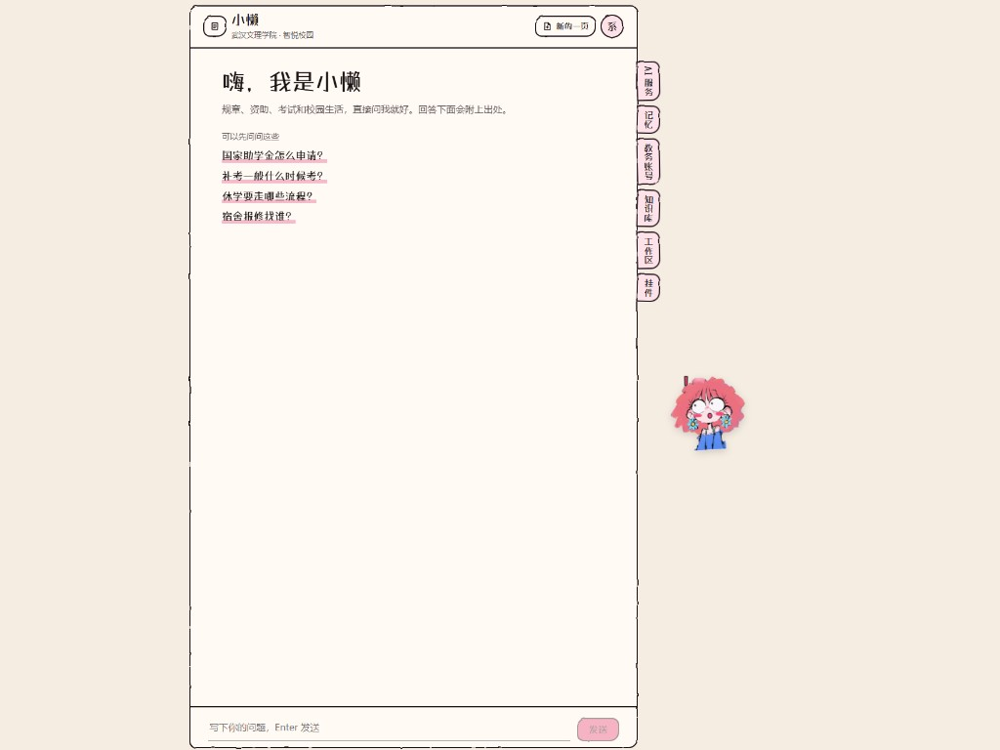
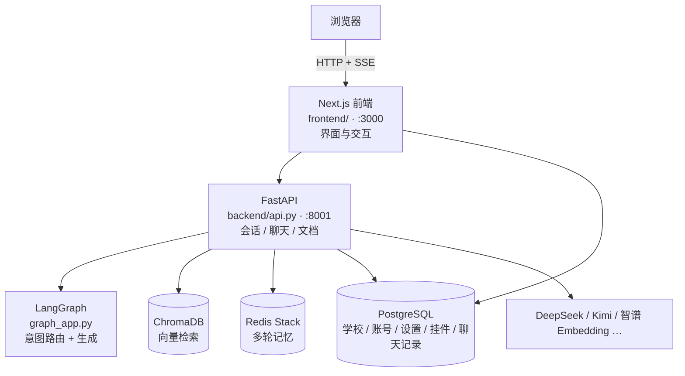

<div align="center">

# 智悦校园 · Smart Campus

**面向校园场景的 AI 问答伴侣**

基于校规 / 学生手册等文档做 RAG 检索，用 LangGraph 做意图路由与多轮对话，前后端分离部署。


[功能](#功能) · [截图](#截图) · [架构](#架构) · [快速开始](#快速开始docker) · [本地开发](#本地开发) · [API](#主要-api) · [文档](#相关文档)

</div>

> 旧版为 Streamlit 一体界面，当前主路径为 **Next.js + FastAPI**。

## 截图

<table>
  <tr>
    <td width="50%" align="center"><b>登录</b></td>
    <td width="50%" align="center"><b>问答主页</b></td>
  </tr>
  <tr>
    <td></td>
    <td></td>
  </tr>
  <tr>
    <td align="center"><sub>填学校标识、学号 / 工号和密码登录，也能注册；输密码时桌宠会闭眼</sub></td>
    <td align="center"><sub>示例问题一键提问；右侧标签进入 AI 服务、记忆、教务账号、知识库、工作区、挂件</sub></td>
  </tr>
</table>

## 功能

### 知识库问答

- 校规 / 学生手册等知识库问答（RAG + 可选重排序）
- SSE 流式聊天、会话恢复（`thread_id` + Redis）
- 文档上传与向量库管理（txt / pdf / md / docx），以及网页导入（贴官网通知链接，服务端抓正文，拦截内网地址）
- 结构化规章维基（`wiki/`，LLM 维护的制度知识沉淀）
- 回答附来源卡片：文件名、相似度与命中片段，历史会话恢复后仍可展开

### 记忆与个性化

- 服务端长期记忆（Redis，按学校 + 用户隔离）：发「记住：xxx」手动记，或在情感分析时顺带自动抽取；换设备不丢

### 学校管理（管理员）

- **每校工作区**：助手名称、人设提示词、只按资料回答（查不到就拒答）、相似度阈值、检索条数、学校心理咨询联系方式
- **每校 AI 服务**：在「AI 服务」页配置学校自己的对话 / 精读模型，密钥加密入库；学生可自带密钥；朗读回答的声音与语速
- **使用情况看板**（抽屉里的「使用情况」，仅管理员）：近 7 / 30 / 90 天的高频问题、没答上来的问题（拒答、没检索到资料、被点踩，说法不同的自动归并）、点赞点踩、各工具的失败率与耗时；每个缺口可以直接写一段标准答案「补进知识库」。提问记录**不带用户身份**，倾诉类问题不存原文，180 天后自动清理
- **点赞 / 点踩**：学生可对每条回答反馈，点踩时可选原因（答非所问 / 信息过期 / 太啰嗦 / 其他），随回答所在会话一并删除

### 贴近学生日常

- **课表放进手机日历**（抽屉「日历」）：本学期每节课和考试导出成 `.ics`，带教室、老师和课前提醒；也可以生成**订阅链接**，调课后手机自己更新。订阅链接就是凭证：只存哈希、只显示一次、可随时重新生成或关闭；整份日历缓存半小时，手机反复来取也不会去打扰教务系统
- **周次与校历**：问「现在第几周」「第 10 周是几号」「这个日期是第几周」，周次取自教务；放假、开学等安排请管理员把校历作为资料上传到知识库，助手会去检索
- **查完顺着问**：查空教室后可直接问「某某楼怎么走」，查成绩后可看每学期绩点、没通过的课，点一下就问
- **图片提问**：拍课表、通知、表格附在输入框问（也可直接粘贴截图），一次最多 2 张。**学校要在「AI 服务 → 图片提问」单独配一个识图模型**（如智谱 GLM-4V、Kimi 视觉、通义千问 VL），网址、模型、密钥三项都填了才开放，没填就看不到「附图」按钮，也不会借用对话模型或平台密钥。流程：浏览器先把图缩到长边 1280 像素 → 识图模型把图读成文字 → 文字当作「资料」接在提问后面交给对话模型。**图片不入库、不记日志**，库里和提问记录里只有学生自己打的字；读出的文字标注「可能有误」，图里的任何指令都不会被执行，证件号、银行卡号不会被转写。访客（嵌入挂件）不能附图

### 情绪陪伴

- 倾诉时换成陪伴式回复（借鉴 ESConv 的 8 种支持策略与 SoulChat / EmoLLM / MeChat 的多轮共情写法，只借方法、不换模型）
- 出现伤害自己的念头时（关键词判定不依赖模型，情绪分析判高风险时再兜一层）附求助卡片：全国心理援助热线 12356、110 / 120、学校心理咨询，**只给学生本人看，不通知任何人**

### 工具问答

问「我明天有什么课」「教务处最近有什么通知」「图书馆怎么走」时，模型按需调用工具再作答，出处附原文或导航链接，每次调用记审计（不记返回内容）。

| 工具 | 说明 |
| --- | --- |
| 教务 | 学生在「工具 → 教务账号」用统一身份认证账号绑定（目前对接正方教务），服务器只加密保存登录后的 Cookie、不存密码，只读查询课表、考试、成绩、空教室；学校没对接时可以开「演示数据」。正式开放前请取得教务处、信息中心同意 |
| 学校通知 | 管理员填官网、教务处的列表页网址，读标题和正文（正文只许打开这些站点上的页面） |
| 地图问路与联网搜索 | 高德「Web 服务」Key、博查 Key，学校在「AI 服务」页填，或服务器 `AMAP_WEB_KEY` / `BOCHA_API_KEY` 兜底；没填就不开放 |

### 嵌入挂件

学校官网贴一行脚本，右下角出现聊天气泡：访客免登录，按来源域名白名单签发 2 小时令牌，可设每日上限、随时停用。

管理员在「工作区与嵌入挂件」里创建后可一键复制嵌入代码：

```html
<script src="https://你的前端域名/embed.js" data-embed-id="挂件ID" defer></script>
```

访客只能问答：不能读写记忆、看文档列表或自带模型密钥；工作区与挂件设置最多 60 秒后生效。

## 架构



| 服务 | 端口 | 说明 |
| --- | --- | --- |
| `web` | 3000 | Next.js 前端 |
| `api` | 8001 | FastAPI 接口 |
| `postgres` | 5433→5432 | PostgreSQL 17（表由 Prisma 建） |
| `migrate` | — | 启动时先建表，成功后 `web` 才起 |
| `redis` | 6380→6379 | Redis Stack（会话 checkpoint） |
| `app`（可选） | 8502 | 旧版 Streamlit，`--profile legacy` |

<details>
<summary><b>目录结构</b></summary>

```
├── backend/          # FastAPI + LangGraph + RAG（含旧版 Streamlit）
├── frontend/         # Next.js 16 + React 19 + Tailwind CSS v4
├── data/             # 预载知识文档
├── wiki/             # 校规知识维基（sources / concepts / topics）
├── docker-compose.yml
├── requirements.txt
└── DEPLOY.md         # 云服务器 Docker 部署详解
```

</details>

## 快速开始（Docker）

**1. 配置密钥**

- `backend/.env`（参考 `backend/.env.example`）：填入 DeepSeek / Kimi / 智谱等密钥。
- 根目录 `.env`（参考 `.env.example`）：填入 `POSTGRES_PASSWORD` 与 `AUTH_JWT_SECRET`。

> [!IMPORTANT]
> 这两个变量未设置时 compose 会直接报错退出。`AUTH_JWT_SECRET` 由 `api` 与 `web` 共用，不会出现两端对不上的情况。

**2. 配置访问地址**

按需修改 `docker-compose.yml` 中 `web.build.args.NEXT_PUBLIC_API_BASE`（浏览器能访问到的 API 地址），并同步 `api` 的 `FRONTEND_ORIGINS`。

**3. 启动**

```bash
docker compose up -d --build
```

`migrate` 会先建表，成功后 `web` 才起。

**4. 创建学校与管理员账号**（仅首次部署）

Postgres 已映射到本机 5433，在 `frontend/` 下执行：

```bash
npm run db:seed
```

**5. 打开**

| 入口 | 地址 |
| --- | --- |
| 前端 | http://localhost:3000 |
| 健康检查 | http://localhost:8001/api/health |

> [!NOTE]
> 除健康检查外，所有 API 都要求登录；上传与清空知识库还需要 STAFF 或 ADMIN 角色。
> 升级已有部署时，`migrate` 会自动建好 `tenant_settings` 与 `embed_configs` 两张新表。

完整上云步骤（打包、Nginx、HTTPS）见 [DEPLOY.md](./DEPLOY.md)。

## 本地开发

### 后端

```powershell
cd backend
# 配置 .env 后
python -m uvicorn api:app --reload --port 8001
```

依赖见根目录 `requirements.txt`。Redis 建议用 compose 只起缓存：

```bash
docker compose up -d redis
# 本机连 Redis 时：REDIS_URL=redis://localhost:6380
```

### 前端

```powershell
cd frontend
copy .env.example .env.local
npm install
npm run dev
```

打开 http://localhost:3000 。更多说明见 [frontend/README.md](./frontend/README.md)。

## 主要 API

<details>
<summary><b>FastAPI（backend）</b></summary>

| 方法 | 路径 | 说明 |
| --- | --- | --- |
| GET | `/api/health` | 健康检查 |
| POST | `/api/sessions` | 新建会话 |
| GET | `/api/sessions/{tid}/messages` | 恢复历史 |
| POST | `/api/chat` | 提问（SSE） |
| GET/POST/DELETE | `/api/documents` | 文档列表 / 上传 / 清空 |
| POST | `/api/documents/url` | 导入网页（STAFF / ADMIN） |
| GET/POST | `/api/memories` | 我的长期记忆：列出 / 新增 |
| DELETE | `/api/memories/{id}` | 删除一条记忆 |
| GET | `/api/workspace` | 本校助手名称与模式、是否开放图片提问（访客可读，访客的图片提问恒为关） |
| GET | `/api/calendar/export` | 下载课表和考试的 `.ics`（`alarm`、`term_start` 可选） |
| GET/POST/DELETE | `/api/calendar/subscription` | 订阅状态 / 生成（令牌只返回一次）/ 关闭 |
| GET | `/api/calendar/feed/{token}.ics` | 日历软件来取的订阅地址（令牌即凭证，不走登录） |
| POST | `/api/feedback` | 对一条回答点赞 / 点踩（rating 为 1 / -1，0 取消） |
| GET | `/api/admin/usage?days=7` | 使用情况报表（ADMIN，需要数据库） |

</details>

<details>
<summary><b>Next.js（frontend，读写 Postgres）</b></summary>

| 方法 | 路径 | 说明 |
| --- | --- | --- |
| GET/PUT | `/api/admin/workspace` | 工作区设置（ADMIN） |
| GET/POST | `/api/admin/embeds` | 挂件列表 / 创建（ADMIN） |
| PATCH/DELETE | `/api/admin/embeds/{id}` | 修改 / 删除挂件（ADMIN） |
| POST | `/api/embed/{id}/token` | 为白名单域名的访客签发令牌（CORS） |

</details>

## 相关文档

| 文档 | 内容 |
| --- | --- |
| [DEPLOY.md](./DEPLOY.md) | Docker / 服务器部署 |
| [backend/启动与部署指南.md](./backend/启动与部署指南.md) | 架构与 Redis 记忆原理 |
| [frontend/README.md](./frontend/README.md) | 前端开发说明 |
| [wiki/overview.md](./wiki/overview.md) | 规章维基总览 |

## License

未指定开源协议时，默认保留所有权利。如需开源请补充 `LICENSE`。
